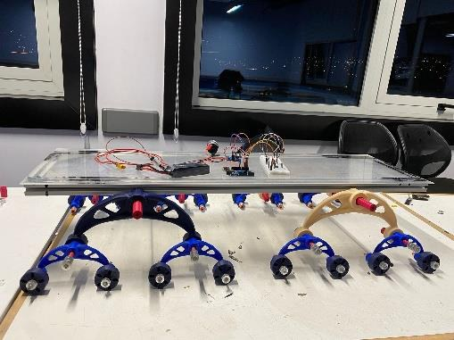
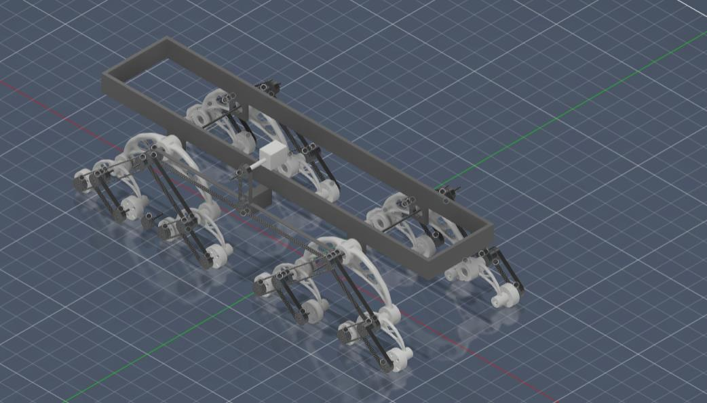
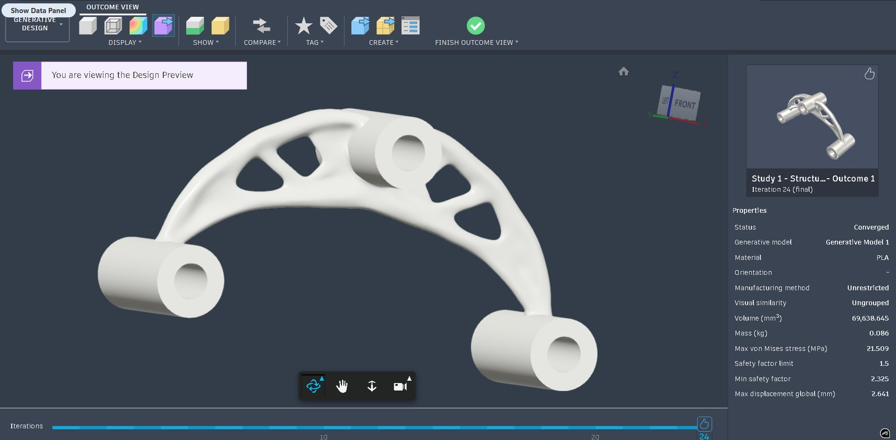
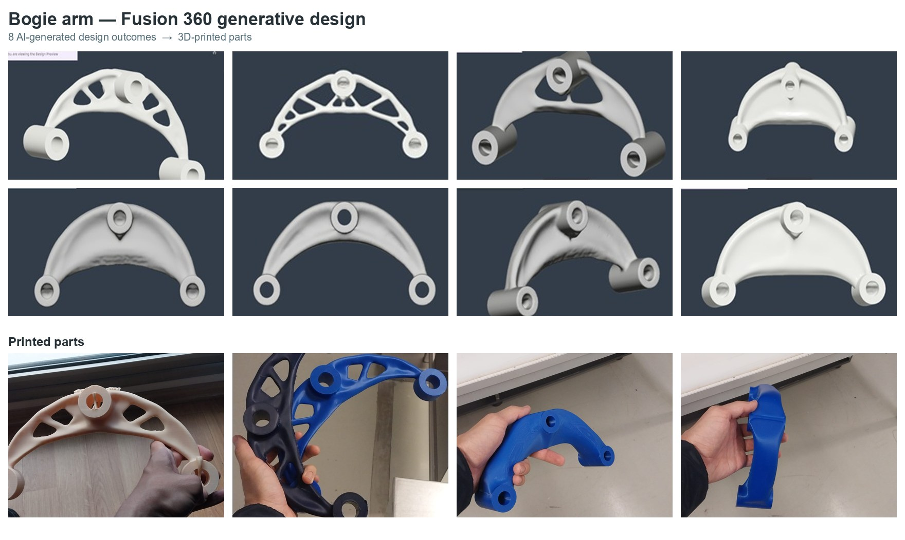
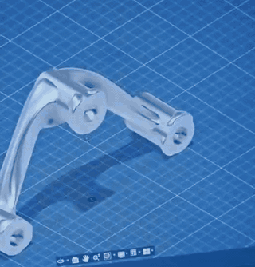
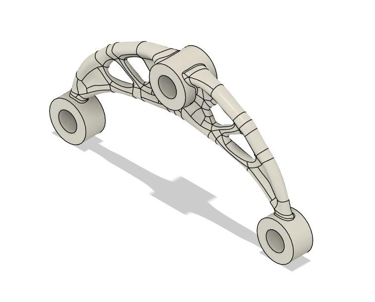
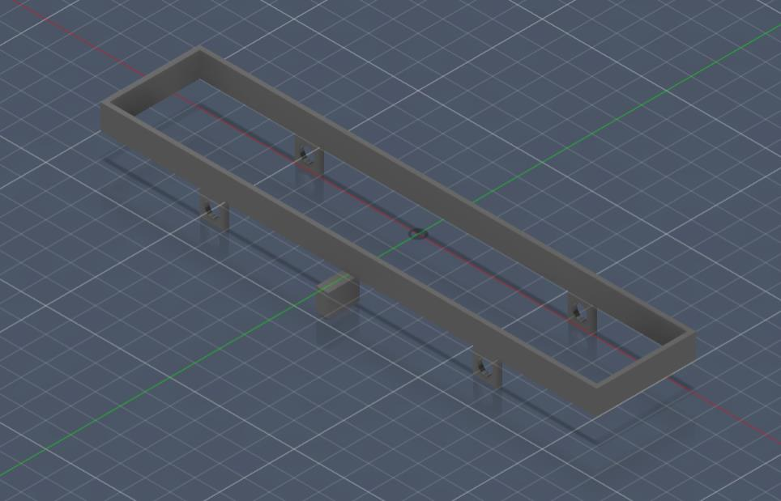
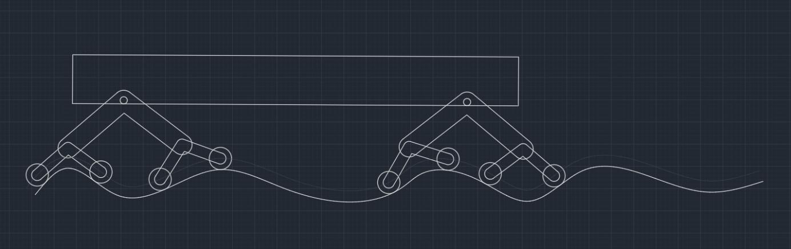
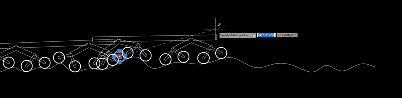
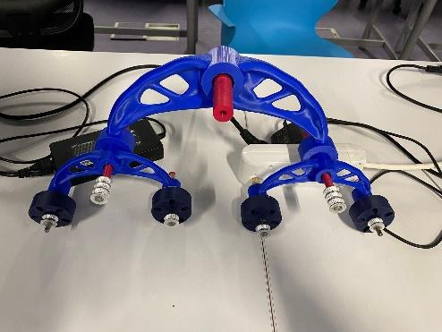

# rover-16-wheel

**One motor, sixteen driven wheels, a two-stage passive bogie suspension, and generatively designed bogie arms that were 3D-printed and assembled into a working prototype.**

*Senior design project (ME4920, Yaşar University, 2025–26), built with my Group 7 teammates. This repo is documentation only: images, specs and the design story. There is no code.*

Project page: [alpserkanmerkit.github.io/mechanical/#rover](https://alpserkanmerkit.github.io/mechanical/#rover)

---

## What I did

I was the **lead CAD designer** on a three-person team.

- Modelled the whole vehicle in **Autodesk Fusion (Fusion 360)**: chassis, primary and secondary bogies, wheels, pulleys, shafts and the belt network.
- Cleaned up the full assembly into a consistent model with **115 occurrences of 14 unique component types**. The team's mass, clearance and kinematic numbers were taken from this model.
- Ran the **Fusion generative design study for the bogie arm**. I compared the candidate outcomes and picked the one with the best balance of mass, stiffness and printability.
- Checked that the drivetrain had enough space around it.
- Worked on the design revisions, including the pulley/belt pitch correction, together with a teammate.

My teammates led the literature review, the kinematic simulations and traction/power calculations, the budget and procurement, and the prototyping and electronics plan.

## Design story

**1. Problem.** Small ground robots on rough terrain need to keep their wheels in contact with the ground. One option is a motor in every wheel, but that adds a lot of unsprung weight and makes control harder. We wanted to drive a multi-wheel vehicle from a **single central motor** and still let the suspension follow uneven ground at low speed.

**2. Concept.** The vehicle uses 16 wheels on a **two-stage passive bogie**, a system of pivoting arms with no springs or actuators. Each small (secondary) bogie arm carries two wheels. Each large (primary) bogie frame carries two secondary arms. Four primary frames are mounted to the chassis. The design was checked against a **benchmark obstacle 50 mm high**. That is twice the wheel radius, so a single wheel cannot roll over it alone and the bogie stages have to lift it.

**3. Drivetrain.** One 12 V geared DC motor drives every wheel through a **4-stage belt network** of TPU (flexible 3D-printing plastic) belts on identical **36-tooth pulleys**. All pulleys are the same size, so the ratio is **1:1** from motor to wheel and every wheel gets the same nominal speed. We chose a belt instead of a chain because a belt runs with less vibration, weighs less and needs no lubrication.

**4. CAD.** The full assembly was modelled in Autodesk Fusion. Mass, the center-of-gravity estimate, bogie lift, chassis clearance and left/right symmetry were all checked against that model.

**5. Generative design.** The bogie arm is the part that moves with the terrain, so its weight matters most. I set up a Fusion generative design study in PLA. The axle and pivot bores were fixed as preserved geometry, and Fusion was free to remove material between them. Several outcomes were screened on mass, safety factor, displacement and printability. The selected arm weighs **0.086 kg**, with a **minimum safety factor of 2.3** (the study limit was 1.5) and **2.6 mm maximum displacement**.

**6. Printed parts → prototype.** The bogie arms and wheels were 3D-printed and assembled under the chassis together with the printed TPU belt. The motor drivetrain ran as intended under **low-load conditions**.

## Specs

All values come from the team's final report and CAD model. They are design and CAD values, not field measurements.

| Item | Value |
|---|---|
| Layout | 16 wheels, two-stage passive bogie (4 primary frames, 8 secondary arms) |
| Drive | 1 central motor → all 16 wheels, 4-stage TPU belt network, 1:1 overall ratio |
| Motor | JGB37-520, 12 V geared DC, 600 rpm nominal |
| Pulleys | 36-tooth, Ø32 mm, identical across the drivetrain |
| Belt links (total) | 2,680 across 4 belt stages |
| Overall envelope | 1130 × 654 × 590 mm |
| Chassis | 600 × 307 × 100 mm |
| Wheels | Ø50 × 20 mm |
| Track gauge / wheel-center span | 323 mm / 948.7 mm |
| Assembly mass (CAD) | 16.7 kg (electronics and battery not included) |
| CAD assembly | 115 occurrences, 14 unique component types |
| Benchmark obstacle | 50 mm high (= 2 × wheel radius) |
| Combined bogie lift (CAD geometry) | 215 mm (primary 138 mm + secondary 77 mm) |
| Static chassis clearance | ≈ 161 mm |
| Generative bogie arm (PLA) | 0.086 kg · min safety factor 2.3 · max displacement 2.6 mm |

### Honest status

We closed the design analytically. These items are still open for full-load testing:

- **Traction:** at the full CAD mass on the 32° benchmark slope, the conservative calculation gives a traction safety factor of 0.96 with the assumed friction coefficient μ = 0.6. Passing needs μ ≥ 0.625, a lighter chassis, or both.
- **Torque:** the benchmark case needs about 2.56 N·m at the motor. The motor's datasheet gives no torque rating, so this still has to be measured.
- **Belt pitch:** the TPU belt-link pitch does not fully match the pulley tooth pitch. The belt works by lug guidance plus friction, and that has to be confirmed in testing.

## Gallery

*Full Autodesk Fusion assembly: the chassis frame, four primary bogie frames, eight secondary arms and 16 wheels, all driven from one central motor.*

*The selected generative design outcome for the bogie arm (PLA, converged). The properties panel shows mass, stress, safety factor and displacement.*

*Generative design outcomes for the bogie arm (top) and 3D-printed arms (bottom). Top-left is the selected outcome shown above; the other seven are candidates that were not selected.*

### Generative study: all outcomes and printed arms

The selected outcome is identified by its values (Outcome 1, iteration 24, 0.086 kg, min safety factor 2.325, max displacement 2.641 mm), not by its label alone: Fusion numbers outcomes per study run, so other runs also have an "Outcome 1" or "Outcome 2". The seven other candidates were screened and not selected. Their screenshots are small phone captures and are shown for comparison only.

| File | What it shows |
|---|---|
| [candidate_01_selected_lattice_arch.jpg](docs/genai/candidate_01_selected_lattice_arch.jpg) | **Selected outcome** (low-resolution capture of the screenshot above) |
| [candidate_02_truss_arch.jpg](docs/genai/candidate_02_truss_arch.jpg) | Candidate, not selected: thin truss arch |
| [candidate_03_open_frame_arm.jpg](docs/genai/candidate_03_open_frame_arm.jpg) | Candidate, not selected: open-frame arm |
| [candidate_04_shell_arch.jpg](docs/genai/candidate_04_shell_arch.jpg) | Candidate, not selected: solid shell arch |
| [candidate_05_shell_arch_notched.jpg](docs/genai/candidate_05_shell_arch_notched.jpg) | Candidate, not selected: shell arch with a notch at the pivot |
| [candidate_06_shell_arch_rough.jpg](docs/genai/candidate_06_shell_arch_rough.jpg) | Candidate, not selected: shell arch, intermediate iteration |
| [candidate_07_slim_arch.jpg](docs/genai/candidate_07_slim_arch.jpg) | Candidate, not selected: slim solid arch |
| [candidate_08_offset_solid_arm.jpg](docs/genai/candidate_08_offset_solid_arm.jpg) | Candidate, not selected: solid arm with offset bores |
| [printed_01_blue_solid_arm_front.jpg](docs/genai/printed_01_blue_solid_arm_front.jpg) | Printed arm (blue PLA), front |
| [printed_02_blue_solid_arm_side.jpg](docs/genai/printed_02_blue_solid_arm_side.jpg) | Same printed arm, side |
| [printed_03_natural_lattice_arch.jpg](docs/genai/printed_03_natural_lattice_arch.jpg) | Printed lattice arch (natural PLA, support marks still on) |
| [printed_04_dark_and_blue_lattice_arms.jpg](docs/genai/printed_04_dark_and_blue_lattice_arms.jpg) | Two printed lattice arms (dark and blue) |

*A generative bogie arm in the Fusion workspace (phone recording of the screen).*

*Primary bogie frame: organic, topology-optimized shape that keeps material on the load paths and cuts unsprung mass.*

*Main chassis frame (600 × 307 × 100 mm). Every bogie and the motor mount to it.*

*2D kinematic layout of the bogie stages following an uneven ground profile. ME4920 Group 7 team work, shown with credit, not licensed.*

*The same 2D layout being dragged over the terrain profile to check the articulation. ME4920 Group 7 team work, shown with credit, not licensed.*

*Prototype close-up: a printed primary bogie frame with two secondary arms and their wheels.*

## Tools

- **Autodesk Fusion (Fusion 360):** part and assembly CAD, mass properties, generative design
- **3D printing:** PLA (bogie arms, wheels), TPU (belt links)
- **Hand calculations:** obstacle geometry, belt/pulley kinematics, traction, torque, contact pressure

## Team & credits

This was a team project by **ME4920 Senior Design Project, Group 7**, Department of Mechanical Engineering, Yaşar University (2025–26). I built it with my Group 7 teammates and our faculty advisor. The CAD, generative design and assembly work described under *What I did* is mine. The kinematic simulations, calculations, budget and prototyping plan were led by my teammates.

## License

Only my own work in this repository is licensed under **CC BY 4.0**: the README text, the CAD images, the generative design images (including [`docs/genai/`](docs/genai/)) and the prototype photos. The exact file list is in [LICENSE](LICENSE).

**Not licensed:** the kinematic study images ([`docs/kinematics_2d.jpg`](docs/kinematics_2d.jpg), [`docs/bogie_terrain_kinematics.gif`](docs/bogie_terrain_kinematics.gif)) and the team's final report are ME4920 Group 7 team work, shown with credit, not licensed. The numbers in this README are quoted from that report.
